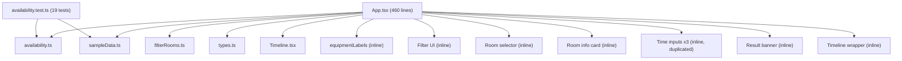
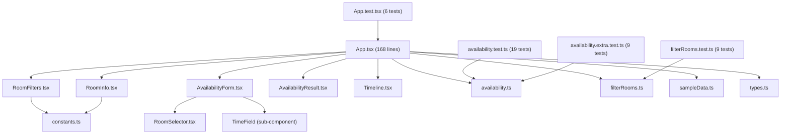

# Assignment #04 — Assignment Report

## Smart Campus Room Availability Checker

**Student tool for checking campus room availability using fictional data.**
Built with React, TypeScript, Vite, Tailwind CSS, and Vitest.

---

## Task #01 — Codebase Analysis and Improvement Plan

### Initial State

The original project was a single-file React application (`App.tsx`, approximately 327 lines) with one supporting logic module (`availability.ts`), one type file (`types.ts`), one data file (`sampleData.ts`), and one visual component (`Timeline.tsx`). It contained 19 automated boundary tests (T01–T19) covering time validation, the 120-minute duration limit, overlap detection, and blocked-room handling. The application had three rooms (A101, B220, C305).

### Three Maintainability Risks Identified

| Risk | Description | Impact |
|------|-------------|--------|
| 1. Monolithic `App.tsx` | All UI rendering, state management, and event handling lived in a single 327-line file. Filters, room selection, time inputs, result display, and timeline rendering were all inline. | Adding any feature required editing one large file, increasing the risk of unintended changes to unrelated sections. |
| 2. Duplicated time-input markup | The three time fields (current, start, end) were copy-pasted blocks — each with a label, numeric input, and conditional `formatTime` preview. | Any change to input styling or validation required updating three identical blocks. Forgetting one would cause inconsistent behavior. |
| 3. No filtering capability | The original had no way to narrow rooms by capacity or equipment. The room list was hardcoded and unfiltered. | Users could not find rooms matching their needs, limiting the tool's usefulness for larger campuses. |

### Prioritized Improvement Plan

1. **Feature extension (Task #02)** — Add capacity and equipment filtering, additional rooms, and an empty-state message. This delivers immediate user-facing value.
2. **Refactoring (Task #03)** — Split `App.tsx` into focused components, extract shared markup, and move constants to a shared module. This reduces the risk of regressions when future features are added.
3. **Automated testing (Task #04)** — Add tests for the new filtering logic and UI behavior to prevent regressions.

### Rejected AI Suggestion

During analysis, the AI tool suggested adding a Supabase database to persist bookings across sessions. This was rejected because the assignment explicitly requires fictional data only, with no databases or APIs. Introducing a database would add unnecessary complexity and violate the assignment constraints.

---

## Task #02 — Feature Extension

### Changes Made

- Added an `equipment` field to the `Room` interface and a new `RoomFilter` interface.
- Added equipment lists to the three existing rooms and introduced two new rooms (D410, E112), bringing the total to five.
- Created `filterRooms.ts` — a pure function that filters rooms by minimum capacity and required equipment (all-items match).
- Updated the UI with a filter panel (capacity input and equipment toggle buttons), equipment badges on room cards, and a clear "no rooms match" message when filters exclude all rooms.
- Ensured that changing the selected room clears the result and uses only that room's bookings.

### F1–F5 Feature Verification

| Feature | Description | How to Verify |
|---------|-------------|---------------|
| F1 | Room capacity must be >= requested attendees | Set minimum capacity to 30; only rooms with 30+ seats appear in the dropdown. |
| F2 | Rooms must contain ALL selected equipment | Select "Projector" + "Video Conferencing"; only rooms with both items appear. |
| F3 | Blocked rooms never reported as available | Select B220 (blocked); any time check returns "Unavailable" with the room-blocked reason. |
| F4 | Clear message when no rooms match | Set capacity to 100; the dropdown is replaced with an amber "no rooms match" message and the check button is disabled. |
| F5 | Changing room refreshes the result | Check availability for A101, then switch to C305; the result clears and the room info updates to show C305's bookings. |

All existing time validation (0–1440 range, start > current, start < end), the 120-minute limit, overlap rules, and touching-interval behavior were preserved without modification.

---

## Task #03 — Refactoring

### Approach

`App.tsx` was reduced from 460 lines (after feature extension) to 168 lines by extracting UI sections into focused components. Shared markup and constants were moved to dedicated modules.

### Duplicated Logic Removed

1. **Three identical time-input blocks** (label + input + formatTime preview) were extracted into a single `TimeField` sub-component inside `AvailabilityForm.tsx`. All three inputs now use `<TimeField>` with different props.
2. **`equipmentLabels` map** was moved from inline in `App.tsx` to `constants.ts`, and is now imported by both `RoomFilters.tsx` and `RoomInfo.tsx`.

### New Component Responsibilities

| Component | Responsibility |
|-----------|---------------|
| `RoomFilters.tsx` | Renders capacity input and equipment toggle buttons; reports match count |
| `RoomSelector.tsx` | Renders room dropdown or empty-state message |
| `AvailabilityForm.tsx` | Renders room selector, three time fields via `TimeField`, and Check/Reset buttons |
| `RoomInfo.tsx` | Renders room card: name, building, capacity, equipment badges, blocked status, bookings list |
| `AvailabilityResult.tsx` | Renders available/unavailable result banner |
| `constants.ts` | Shared equipment labels and time/duration constants |
| `filterRooms.ts` | Pure filtering function (capacity + equipment) |

### BEFORE Diagram



### AFTER Diagram



### Design Decisions

1. **`TimeField` sub-component** — The three time-input blocks were identical except for label, placeholder, and value. Extracting them into one reusable component reduced ~90 lines of duplicated JSX to ~25 lines. If a fourth time field is ever needed, it is a one-line addition.

2. **`constants.ts` for shared labels** — The `equipmentLabels` map was referenced in two separate render sections (filter buttons and room badges). Moving it to a shared module ensures a single source of truth; adding a new equipment type requires updating only one file.

---

## Task #04 — Automated Testing

### Test Files Created

| File | Tests | Coverage |
|------|-------|----------|
| `src/lib/filterRooms.test.ts` | 9 | F1 (capacity: exact, insufficient, above, zero) and F2 (equipment: single, all, missing, none, combined) |
| `src/lib/availability.extra.test.ts` | 9 | F3 (blocked: no-overlap, overlap, custom) and boundary conditions (120 min exact, 121 min rejected, touching both directions, partial and full overlap) |
| `src/App.test.tsx` | 6 | F4 (empty state via capacity, via equipment, check button disabled) and F5 (room change clears result, bookings update, reset clears) |

### Actual Test Results

```
Test Files  4 passed (4)
     Tests  43 passed (43)
```

All 19 original tests (T01–T19) were preserved and still pass. No business logic was modified to make tests pass.

### Boundary Conditions Tested

| Condition | Test ID | Result |
|-----------|---------|--------|
| Duration exactly 120 minutes | T10, B120-EXACT | PASS — available |
| Duration 121 minutes | T11, B121-REJECTED | PASS — rejected as too-long |
| Touching interval (end = booking.start) | T19, BTOUCH-END-AT-START | PASS — available |
| Touching interval (start = booking.end) | T14, BTOUCH-START-AT-END | PASS — available |
| Overlapping interval (partial) | T13, BOVERLAP-PARTIAL | PASS — rejected as overlap |
| Overlapping interval (full) | T17, BOVERLAP-FULL | PASS — rejected as overlap |
| Exact capacity match | F1-EXACT | PASS — included |
| Insufficient capacity | F1-INSUFFICIENT | PASS — excluded |

---

## Task #05 — Quality Evaluation

### Original vs. Final Comparison

| Metric | Original | Final | How Measured |
|--------|----------|-------|--------------|
| Automated tests | 19 passed / 19 total | 43 passed / 43 total | `npx vitest run --reporter=verbose` |
| Test files | 1 | 4 | Vitest output |
| `App.tsx` size | ~327 lines (pre-extension), ~460 lines (post-extension) | 168 lines | `wc -l src/App.tsx` |
| Component files | 1 (`Timeline.tsx`) | 7 | Project file listing |
| Logic modules | 3 | 5 | Project file listing |
| Rooms | 3 | 5 | `sampleData.ts` inspection |
| Production build | Passing | Passing | `npm run build` |

### Duplicated Logic Reductions (Verified)

1. Time-input blocks: 3 inline copies in original → 1 `TimeField` component (confirmed in `AvailabilityForm.tsx` lines 21–57, 96–121).
2. Equipment labels: 1 inline map in `App.tsx` → 1 export in `constants.ts` imported by 2 components (confirmed via imports in `RoomFilters.tsx` line 3 and `RoomInfo.tsx` line 12).

### Remaining Limitations

1. **Unused constants** — `TIME_MIN`, `TIME_MAX`, and `MAX_DURATION` in `constants.ts` are exported but not imported by `availability.ts`, which still uses hardcoded literals (0, 1440, 120). The values exist in two places and could diverge.
2. **Integration tests are not isolated** — The six UI tests mount the full `App` component, so a failure in one child component could cause tests targeting other components to fail.
3. **No accessibility or visual regression tests** — Color contrast, keyboard navigation, and screen-reader behavior are not covered by automated tests.

---

## Task #06 — Final Submission

Final verification was performed on 2026-11-12. All 43 tests pass and the production build completes without errors.

### Commands Executed

```bash
npm test          # 43 passed, 0 failed, 4 test files
npm run build     # 1,578 modules transformed, no errors
```

### Final File List

| Category | Files |
|----------|-------|
| Documentation | `README.md`, `ASSIGNMENT_REPORT.md`, `AI_EVIDENCE.md` |
| Application | `src/App.tsx`, `src/main.tsx`, `src/index.css` |
| Components | `src/components/AvailabilityForm.tsx`, `src/components/AvailabilityResult.tsx`, `src/components/RoomFilters.tsx`, `src/components/RoomInfo.tsx`, `src/components/RoomSelector.tsx`, `src/components/Timeline.tsx` |
| Logic | `src/lib/availability.ts`, `src/lib/constants.ts`, `src/lib/filterRooms.ts`, `src/lib/sampleData.ts`, `src/lib/types.ts` |
| Tests | `src/lib/availability.test.ts`, `src/lib/availability.extra.test.ts`, `src/lib/filterRooms.test.ts`, `src/App.test.tsx`, `src/test-setup.ts` |
| Config | `vite.config.ts`, `tsconfig.json`, `tsconfig.app.json`, `tsconfig.node.json`, `tailwind.config.js`, `postcss.config.js`, `eslint.config.js`, `package.json` |

---

## AI Reflection

The AI tool (Bolt.new) was used across six tasks to extend, refactor, test, and document this application. Its main strength was speed: it produced working code for new features, component splits, and test files in a fraction of the time manual coding would require. The tool followed instructions well — when told not to modify business rules, it preserved all 19 existing tests without changing `availability.ts`.

However, the AI was not fully reliable on its own. During Task #04, the first test run produced 6 failures because the tests did not account for duplicate DOM elements (the "no rooms match" message appears in two places, and booking titles appear in both the room card and the timeline). These required iterative debugging — reading error output, adjusting queries from `getByText` to `getAllByText`, and re-running. The tool also created unused constants (`TIME_MIN`, `TIME_MAX`, `MAX_DURATION`) in `constants.ts` that were never wired into `availability.ts`, a minor inconsistency that a human reviewer caught but the tool did not flag.

The key lesson is that AI-generated code and tests need human verification. The tool can produce a strong first draft quickly, but accurate results require reading the output, running the tests, fixing failures, and honestly reporting what was verified versus what was not. In this assignment, every test count and line count in the report was confirmed by actual command execution, not estimated.
